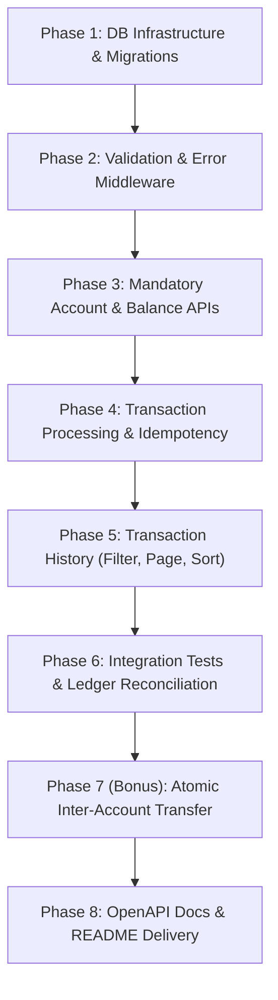

# Revised Implementation Plan: Transaction Ledger API Service

This technical design document outlines the complete architecture, database schema, concurrency controls, idempotency guarantees, security safeguards, and testing roadmap for the **Transaction Ledger System** as specified in the Confluencr assessment.

---

## 1. Goal Description & Scope

Build an ACID-compliant, high-reliability **Transaction Ledger Backend Service** in **Node.js, TypeScript, and Express** backed by **PostgreSQL** using the native `pg` driver (`pg.Pool`).

### System Boundaries:
- **Mandatory Assignment Scope**:
  1. **Create Account**: Server-generated UUID, database-generated timestamps, default balance strictly \$0.00. Client is prevented from setting an initial balance.
  2. **Add Transaction (Credit)**: Atomically increments account balance and records an immutable ledger entry.
  3. **Add Transaction (Debit)**: Evaluates sufficient balance, atomically decrements account balance, and records an immutable ledger entry. Fails without modifying balance if funds are insufficient.
  4. **Idempotency**: Prevents duplicate transactions with the same `reference_id` on the same account. The same reference ID is permitted across different accounts.
  5. **Get Account Balance**: Queries real-time balance for an existing account; returns distinguishable 404 error if missing.
  6. **Get Transaction History**: Retrieves ledger entries filtered by optional type (`credit`/`debit`), paginated (`page`, `limit`), and strictly sorted latest-first (`created_at DESC, id DESC`).
- **Optional Bonus Scope**:
  - **Inter-Account Money Transfer**: Atomically debits source and credits destination in a single transaction with deadlock avoidance. Implemented **only after** all mandatory features and tests pass.
- **Explicit Non-Goals (Out of Scope)**:
  - Microservices, Redis, Kafka/message queues, client frontend, cloud deployment, and user authentication/JWT (not required by the assessment).

---

## 2. Mandatory Assessment Requirements (Line-by-Line)

| Section | Assessment Requirement | Engineering Implementation & Contract |
| :--- | :--- | :--- |
| **1. Create Account** | Unique `id`, `name` required, balance must always start at `0`, `created_at` generated by system, client forbidden from setting initial balance. | - Server/DB generates UUIDv4 via native `gen_random_uuid()`.<br>- Trimmed, non-empty `name` (`z.string().trim().min(1)`).<br>- Strict Zod schema rejects any unexpected fields (including `balance`).<br>- DB default `balance NUMERIC(15, 2) NOT NULL DEFAULT 0.00`.<br>- Service layer ignores/never reads initial balance from client. |
| **2. Add Transaction (Credit)** | Credit increases account balance by transaction amount (`amount > 0`). | - Atomic database transaction: increment account balance and insert ledger record. |
| **2. Add Transaction (Debit)** | Debit decreases account balance; must be **rejected** if account does not have sufficient balance. | - Row-level locking (`SELECT ... FOR UPDATE`) prevents concurrent overdrafts.<br>- Evaluate `current_balance >= amount`.<br>- Return `422 Unprocessable Entity` (`INSUFFICIENT_FUNDS`) if insufficient.<br>- Balance remains unchanged. |
| **2. Idempotency** | Duplicate `reference_id` for the **same account** must be rejected without altering balance; same `reference_id` allowed across *different* accounts. | - Composite DB constraint: `UNIQUE (account_id, reference_id)`.<br>- Catch PostgreSQL error code `23505` (`unique_violation`).<br>- Return `409 Conflict` (`DUPLICATE_TRANSACTION`). |
| **3. Get Balance** | Fetch current balance of an account (`account_id`, `balance`). Return error if not found. | - `GET /api/v1/accounts/:accountId/balance`.<br>- Return `404 Not Found` (`ACCOUNT_NOT_FOUND`) if account missing. |
| **4. History & Filtering** | Fetch transactions for an account with optional `type` filter (`credit` / `debit`). Both returned if omitted. | - Query parameter `?type=credit\|debit`. If omitted or empty, return both credit and debit transactions. |
| **4. Pagination & Sorting** | Support `page` and `limit`. Return `current_page`, `page_size`, `total_records`, `total_pages`. Sorted **latest-first** (`created_at DESC, id DESC`). | - SQL `LIMIT` & `OFFSET` with a dedicated count query to ensure correct metadata even for empty/out-of-range pages.<br>- Deterministic tie-breaker: `ORDER BY created_at DESC, id DESC`. |
| **5. Immutability & Consistency** | Transactions can never be edited or deleted. Balance must strictly equal cumulative valid transactions. | - **No `PUT`, `PATCH`, or `DELETE` endpoints** exposed for transactions.<br>- Repository layer only implements `insert` and `select`.<br>- Balance updates strictly wrapped in ACID transactions. |
| **6. Atomicity** | Creating a transaction and updating balance must be one atomic operation; rollback on any failure. | - Managed database transaction using a single checked-out `pg.PoolClient` (`BEGIN ... COMMIT / ROLLBACK`). |
| **7 & 8. Validations & Errors** | Validate all incoming data. Proper HTTP status codes (`400`, `404`, `409`, `422`, `500`) and standard error envelope. | - Zod middleware for body, params, and queries.<br>- Centralized `errorHandler` returning `{ success: false, error: { code, message, details } }`. |
| **9. Bonus: Money Transfer** | Transfer funds between Account A and Account B atomically. Both must exist; source must have balance. Rollback if any step fails. | - Atomic inter-account transfer `POST /api/v1/transfers`.<br>- **Deadlock avoidance**: Lock accounts in sorted UUID order (`min(idA, idB)` then `max(idA, idB)`). |

---

## 3. Technology Stack & Architectural Decision Record

- **Runtime & Language**: Node.js (v20+ / v24) + TypeScript (strict mode, NodeNext ESM).
- **Web Framework**: Express.js configured with layered architecture:
  `Routes -> Controllers -> Services -> Repositories -> Database Infrastructure`.
- **Database Driver**: PostgreSQL with native `pg` library (`pg.Pool`), eliminating heavy ORM overhead and ensuring full control over connection pooling, row locks, and transaction lifecycles.
- **Database Migrations**: Plain SQL migration files executed via a lightweight migration runner (`src/db/migrate.ts`).
- **Validation**: Zod runtime schema validation on all inputs (request body, route params, query parameters).
- **Testing**: Node.js native test runner (`node --test`) or Jest/Vitest with `supertest` for comprehensive unit and PostgreSQL integration tests.
- **API Documentation**: OpenAPI 3.1 specification (`docs/openapi.yaml`).

---

## 4. Database Infrastructure & Transaction Management

### PostgreSQL Pool Module (`src/db/pool.ts`)
The application manages database connections using a singleton `pg.Pool` instance configured via validated environment variables:
- `DATABASE_URL` (or discrete `PGHOST`, `PGPORT`, `PGUSER`, `PGPASSWORD`, `PGDATABASE`).
- `max`: 20 connections max.
- `idleTimeoutMillis`: 30,000 ms.
- `connectionTimeoutMillis`: 5,000 ms.

### Transaction Helper & Safe Lifecycle Management (`src/db/transaction.ts`)
Every multi-statement operation (debit, credit, transfer) must use **one single checked-out `PoolClient`** for all queries between `BEGIN` and `COMMIT` or `ROLLBACK`. Calling `pool.query()` inside a transaction is strictly prohibited.

```typescript
import { PoolClient } from 'pg';
import { pool } from './pool.js';
import { logger } from '../config/logger.js';

export async function withTransaction<T>(
  callback: (client: PoolClient) => Promise<T>
): Promise<T> {
  const client = await pool.connect();
  try {
    await client.query('BEGIN');
    const result = await callback(client);
    await client.query('COMMIT');
    return result;
  } catch (err) {
    try {
      await client.query('ROLLBACK');
    } catch (rollbackErr) {
      logger.error('Database transaction ROLLBACK failed', {
        error: rollbackErr,
        originalError: err,
      });
    }
    throw err;
  } finally {
    client.release();
  }
}
```

#### Safe Rollback & Client Release Guarantees:
1. **Unconditional Release**: `client.release()` is placed inside a `finally` block, ensuring connections are never leaked even if queries fail or throw.
2. **Rollback Resilience**: If `ROLLBACK` fails (e.g. underlying socket drop), the error is logged with full context, and the originating error is preserved and propagated.
3. **Structured Logging**: Errors are logged through `logger` with structured metadata; no raw credentials or SQL connection strings are leaked to clients.

---

## 5. Database Schema Design & Migration Strategy

### Native UUID Generation
Modern PostgreSQL (v13+) provides `gen_random_uuid()` natively in the core distribution. **No external extensions (`uuid-ossp`) are required or created**, avoiding superuser privilege requirements in managed environments.

### Migration Script: `src/db/migrations/001_init_ledger.sql`

```sql
-- Table 1: Accounts
CREATE TABLE IF NOT EXISTS accounts (
  id UUID PRIMARY KEY DEFAULT gen_random_uuid(),
  name VARCHAR(255) NOT NULL,
  balance NUMERIC(15, 2) NOT NULL DEFAULT 0.00,
  created_at TIMESTAMPTZ NOT NULL DEFAULT CURRENT_TIMESTAMP,
  updated_at TIMESTAMPTZ NOT NULL DEFAULT CURRENT_TIMESTAMP,
  CONSTRAINT chk_account_name_non_empty CHECK (char_length(trim(name)) > 0),
  CONSTRAINT chk_account_balance_non_negative CHECK (balance >= 0.00)
);

-- Table 2: Transactions (Append-Only Immutable Ledger)
CREATE TABLE IF NOT EXISTS transactions (
  id UUID PRIMARY KEY DEFAULT gen_random_uuid(),
  account_id UUID NOT NULL REFERENCES accounts(id) ON DELETE RESTRICT,
  type VARCHAR(10) NOT NULL,
  amount NUMERIC(15, 2) NOT NULL,
  description VARCHAR(500) NOT NULL DEFAULT '',
  reference_id VARCHAR(100) NOT NULL,
  created_at TIMESTAMPTZ NOT NULL DEFAULT CURRENT_TIMESTAMP,
  CONSTRAINT chk_transaction_type CHECK (type IN ('credit', 'debit')),
  CONSTRAINT chk_transaction_amount_positive CHECK (amount > 0.00),
  CONSTRAINT uq_account_reference UNIQUE (account_id, reference_id)
);

-- High-performance composite index for latest-first history queries
CREATE INDEX IF NOT EXISTS idx_transactions_account_created 
  ON transactions (account_id, created_at DESC, id DESC);

-- Table 3 (Bonus): Transfers Audit Journal
CREATE TABLE IF NOT EXISTS transfers (
  id UUID PRIMARY KEY DEFAULT gen_random_uuid(),
  source_account_id UUID NOT NULL REFERENCES accounts(id),
  destination_account_id UUID NOT NULL REFERENCES accounts(id),
  amount NUMERIC(15, 2) NOT NULL,
  source_transaction_id UUID NOT NULL REFERENCES transactions(id),
  destination_transaction_id UUID NOT NULL REFERENCES transactions(id),
  reference_id VARCHAR(100) NOT NULL UNIQUE,
  created_at TIMESTAMPTZ NOT NULL DEFAULT CURRENT_TIMESTAMP,
  CONSTRAINT chk_transfer_amount_positive CHECK (amount > 0.00),
  CONSTRAINT chk_transfer_distinct_accounts CHECK (source_account_id <> destination_account_id)
);
```

### Column Specifications & Data Integrity:

#### Table: `accounts`
| Column | Type | Constraints & Defaults | Integrity & Security Purpose |
| :--- | :--- | :--- | :--- |
| `id` | `UUID` | `PRIMARY KEY DEFAULT gen_random_uuid()` | Non-sequential, unguessable identifier. |
| `name` | `VARCHAR(255)` | `NOT NULL`, `CHECK (char_length(trim(name)) > 0)` | Rejects empty or whitespace-only names. |
| `balance` | `NUMERIC(15, 2)` | `NOT NULL DEFAULT 0.00`, `CHECK (balance >= 0.00)` | Hard DB constraint against overdrafts. Client cannot supply initial balance. |
| `created_at` | `TIMESTAMPTZ` | `NOT NULL DEFAULT CURRENT_TIMESTAMP` | System-generated immutable timestamp. |
| `updated_at` | `TIMESTAMPTZ` | `NOT NULL DEFAULT CURRENT_TIMESTAMP` | Updated explicitly during balance mutation queries: `updated_at = CURRENT_TIMESTAMP`. |

#### Table: `transactions`
| Column | Type | Constraints & Defaults | Integrity & Security Purpose |
| :--- | :--- | :--- | :--- |
| `id` | `UUID` | `PRIMARY KEY DEFAULT gen_random_uuid()` | Unique transaction ID. |
| `account_id` | `UUID` | `NOT NULL`, `FK -> accounts(id) ON DELETE RESTRICT` | Prevents deleting accounts with financial history. |
| `type` | `VARCHAR(10)` | `NOT NULL`, `CHECK (type IN ('credit', 'debit'))` | Strict whitelist enum. |
| `amount` | `NUMERIC(15, 2)` | `NOT NULL`, `CHECK (amount > 0.00)` | Strict DB constraint ensuring positive amounts. |
| `description` | `VARCHAR(500)` | `NOT NULL DEFAULT ''` | Max 500 chars, trimmed. |
| `reference_id` | `VARCHAR(100)` | `NOT NULL` | Client-provided idempotency key. |
| `created_at` | `TIMESTAMPTZ` | `NOT NULL DEFAULT CURRENT_TIMESTAMP` | Basis for deterministic latest-first ordering. |
| **Constraint** | `UNIQUE` | `(account_id, reference_id)` | Scoped idempotency per account. |

---

## 6. Monetary Precision & Arithmetic Strategy

### Principles:
1. **No JavaScript Floating-Point Arithmetic**: JavaScript `Number` (IEEE-754) introduces rounding artifacts (`0.1 + 0.2 = 0.30000000000000004`). Arbitrary floating-point math and conversions such as `Math.round(val * 100)` are **strictly forbidden**.
2. **Database Storage & Calculation**: Monetary values are stored as PostgreSQL `NUMERIC(15, 2)`. Balance increments and decrements are executed **directly in SQL** inside the atomic transaction:
   - Credit: `UPDATE accounts SET balance = balance + $1, updated_at = CURRENT_TIMESTAMP WHERE id = $2 RETURNING balance;`
   - Debit: `UPDATE accounts SET balance = balance - $1, updated_at = CURRENT_TIMESTAMP WHERE id = $2 RETURNING balance;`
   PostgreSQL executes exact fixed-point arithmetic without precision loss.
3. **Application Layer Validation via Zod**:
   - Monetary inputs are accepted as **decimal strings** (e.g. `"50.00"`, `"100.50"`).
   - Format regex: `/^\d+(\.\d{1,2})?$/` (at most 2 decimal places).
   - Positive check: Amount parsed as minor units (cents) must be `> 0`.
   - Maximum amount limit: `amount <= "999999999999.99"` (preventing numeric overflow beyond `NUMERIC(15, 2)`).
4. **Minor-Unit (Cents) Conversion Utility (`src/utils/money.ts`)**:
   For in-memory balance comparisons (e.g., verifying `currentBalance >= amount`), strings are converted to `BigInt` minor units (cents) without floating-point math:
   ```typescript
   export function parseDecimalStringToCents(amountStr: string): bigint {
     const [whole, fraction = ''] = amountStr.split('.');
     const paddedFraction = (fraction + '00').slice(0, 2);
     return BigInt(whole) * 100n + BigInt(paddedFraction);
   }

   export function centsToDecimalString(cents: bigint): string {
     const isNegative = cents < 0n;
     const absCents = isNegative ? -cents : cents;
     const whole = absCents / 100n;
     const fraction = absCents % 100n;
     const paddedFraction = fraction.toString().padStart(2, '0');
     return `${isNegative ? '-' : ''}${whole}.${paddedFraction}`;
   }
   ```
5. **Standardized API Serialization**:
   All monetary amounts in request and response payloads are formatted consistently as 2-decimal strings (e.g., `"0.00"`, `"50.00"`, `"100.50"`).

---

## 7. Concurrency Strategy & Row-Level Locking

### Concurrency Mechanism: Pessimistic Row Locking (`SELECT ... FOR UPDATE`)
We evaluated two valid concurrency control mechanisms:
1. **Conditional Update**:
   `UPDATE accounts SET balance = balance - $1 WHERE id = $2 AND balance >= $1 RETURNING balance;`
2. **Pessimistic Row Locking**:
   `SELECT id, balance FROM accounts WHERE id = $1 FOR UPDATE;` followed by balance verification, ledger insertion, and balance update.

### Rationale:
- **Error Disambiguation**: The assessment explicitly demands distinguishing between **"Account not found" (`404`)** and **"Insufficient balance" (`422`)**. A conditional update returning 0 rows cannot differentiate between a non-existent account and an account with insufficient funds without a subsequent query.
- **Strict Atomicity**: `SELECT ... FOR UPDATE` immediately locks the account row on the checked-out client:
  1. If account is absent $\rightarrow$ throws `NotFoundError` (`404`).
  2. If debit amount exceeds balance $\rightarrow$ throws `InsufficientFundsError` (`422`).
  3. Inserts ledger row into `transactions` (catching `23505` if reference is duplicate).
  4. Updates `accounts.balance` and sets `updated_at = CURRENT_TIMESTAMP`.
  5. Releases lock upon `COMMIT` or `ROLLBACK`.
- **Contention Reality**: Both approaches serialize updates to the same account row in PostgreSQL. `SELECT ... FOR UPDATE` cleanly manages contention without race conditions.

---

## 8. Idempotency & Unique-Violation Handling

- **Database-Enforced Constraint**: `UNIQUE (account_id, reference_id)` guarantees uniqueness at the storage engine level.
- **Handling Race Conditions**:
  - The application catches PostgreSQL error code `23505` (`unique_violation`) when `err.constraint === 'uq_account_reference'`.
  - The repository translates this into a domain `DuplicateTransactionError`:
    - HTTP Status: `409 Conflict`
    - Error Code: `DUPLICATE_TRANSACTION`
    - Message: `"Transaction with reference_id '<reference_id>' already exists for this account."`
- **Reusability Across Accounts**: The same `reference_id` can be used on different accounts without collision.

---

## 9. Transaction History: Filtering, Pagination & Sorting

- **Filter Handling**:
  - Query parameter: `type` (`'credit'` | `'debit'`).
  - If `type` is omitted, `undefined`, or an empty string `""`, the filter is bypassed, returning both credit and debit transactions.
- **Pagination Parameters**:
  - `page`: positive integer, default `1`.
  - `limit`: positive integer, default `10`, maximum `100`.
- **Out-of-Range & Empty Result Strategy**:
  - To prevent incorrect total record counts when requesting out-of-range pages (e.g. page 50 of 2), the repository runs **two coordinated queries**:
    1. Count query: `SELECT COUNT(*)::int AS total FROM transactions WHERE account_id = $1 [AND type = $2]`
    2. Data query: `SELECT id, account_id, type, amount, description, reference_id, created_at FROM transactions WHERE account_id = $1 [AND type = $2] ORDER BY created_at DESC, id DESC LIMIT $limit OFFSET $offset`
  - If a requested page exceeds `total_pages`, the API returns `transactions: []` while preserving accurate `total_records`, `total_pages`, and `current_page`.
- **Stable Sorting**:
  - `ORDER BY created_at DESC, id DESC` guarantees deterministic order even when consecutive transactions share identical millisecond timestamps.

---

## 10. Ledger Immutability & Balance Reconciliation

- **No Mutating Endpoints**: The API exposes zero `PUT`, `PATCH`, or `DELETE` endpoints for `/transactions`.
- **Repository Encapsulation**: `transaction.repository.ts` exposes only `create` and `find` methods. No update or delete methods exist in application code.
- **Mathematical Balance Consistency**:
  $$\text{Account Balance} \equiv \sum_{i \in \text{Credits}} \text{Amount}_i - \sum_{j \in \text{Debits}} \text{Amount}_j$$
- **Reconciliation Integration Test**: Automated tests compute the sum of credits minus debits from `transactions` and assert exact equality with `accounts.balance`.

---

## 11. Security & Reliability Architecture

```
Client Request
      │
      ▼
┌────────────────────────────────────────────────────────┐
│ Express Security & Middleware Pipeline                 │
│  - Helmet (CSP, HSTS, X-Frame-Options)                 │
│  - CORS (Controlled Origins)                           │
│  - Rate Limiting (Brute-force / DoS defense)           │
│  - Body Parser (10kb Limit - Payload DoS Defense)      │
└───────────────────────────┬────────────────────────────┘
                            │
                            ▼
┌────────────────────────────────────────────────────────┐
│ Zod Validation Middleware                              │
│  - Strict Schema Parsing (strip/reject extra fields)   │
│  - UUID format validation                              │
│  - Decimal string amount validation (regex, positive)  │
└───────────────────────────┬────────────────────────────┘
                            │
                            ▼
┌────────────────────────────────────────────────────────┐
│ Service Layer (Business Logic & Concurrency Control)   │
│  - withTransaction Client Checkout                     │
│  - Pessimistic Row Lock: SELECT ... FOR UPDATE         │
│  - Exact Minor-Unit Comparison (BigInt cents)          │
└───────────────────────────┬────────────────────────────┘
                            │
                            ▼
┌────────────────────────────────────────────────────────┐
│ Database (PostgreSQL ACID Engine)                      │
│  - BEGIN TRANSACTION                                   │
│  - CHECK (balance >= 0.00)                             │
│  - CHECK (amount > 0.00)                               │
│  - CONSTRAINT uq_account_reference UNIQUE              │
│  - COMMIT / ROLLBACK                                   │
└────────────────────────────────────────────────────────┘
```

- **Scope Boundary**: Authentication (JWT) is omitted as an agreed design boundary.

---

## 12. Complete API Contract Specifications

All endpoints return a standardized envelope:
- **Success**: `{ "success": true, "data": { ... }, "meta": { ... } }`
- **Error**: `{ "success": false, "error": { "code": "...", "message": "...", "details": [...] } }`

### 1. Create Account
- **Endpoint**: `POST /api/v1/accounts`
- **Request Body**:
  ```json
  {
    "name": "Jane Doe"
  }
  ```
- **Validation**:
  - `name`: non-empty string, trimmed, min 1 char, max 255 chars.
  - Schema configured with `.strict()`: passing `balance` or unknown properties triggers `400 Bad Request`.
- **Response (201 Created)**:
  ```json
  {
    "success": true,
    "data": {
      "id": "a98c8f8e-42c2-47e1-889b-82f534891bca",
      "name": "Jane Doe",
      "balance": "0.00",
      "created_at": "2026-10-27T15:45:00.000Z"
    }
  }
  ```

### 2. Add Transaction
- **Endpoint**: `POST /api/v1/accounts/:accountId/transactions`
- **Request Body**:
  ```json
  {
    "type": "credit",
    "amount": "100.50",
    "description": "Invoice payment #1042",
    "reference_id": "REF-992144"
  }
  ```
- **Validation**:
  - `accountId`: Valid UUIDv4 string.
  - `type`: Must be `'credit'` or `'debit'`.
  - `amount`: Decimal string matching `/^\d+(\.\d{1,2})?$/`, amount > `"0.00"`.
  - `reference_id`: Non-empty string, max 100 chars.
  - `description`: Optional/string, max 500 chars.
- **Success Response (201 Created)**:
  ```json
  {
    "success": true,
    "data": {
      "id": "e4b2d398-3482-411a-9418-2e38c92819ab",
      "account_id": "a98c8f8e-42c2-47e1-889b-82f534891bca",
      "type": "credit",
      "amount": "100.50",
      "description": "Invoice payment #1042",
      "reference_id": "REF-992144",
      "current_balance": "100.50",
      "created_at": "2026-10-27T15:46:00.000Z"
    }
  }
  ```
- **Error Responses**:
  - `400 Bad Request` (`VALIDATION_ERROR`): Invalid amount format, negative amount, or malformed UUID.
  - `404 Not Found` (`ACCOUNT_NOT_FOUND`): Account does not exist.
  - `409 Conflict` (`DUPLICATE_TRANSACTION`): Duplicate `reference_id` on the same account.
  - `422 Unprocessable Entity` (`INSUFFICIENT_FUNDS`): Debit amount exceeds available balance.

### 3. Get Account Balance
- **Endpoint**: `GET /api/v1/accounts/:accountId/balance`
- **Success Response (200 OK)**:
  ```json
  {
    "success": true,
    "data": {
      "account_id": "a98c8f8e-42c2-47e1-889b-82f534891bca",
      "name": "Jane Doe",
      "balance": "100.50"
    }
  }
  ```
- **Error Responses**:
  - `400 Bad Request` (invalid UUID format).
  - `404 Not Found` (`ACCOUNT_NOT_FOUND`).

### 4. Get Transaction History
- **Endpoint**: `GET /api/v1/accounts/:accountId/transactions?type=credit&page=1&limit=10`
- **Query Parameters**:
  - `type` (optional): `'credit'` | `'debit'`. Defaults to returning both if omitted or empty.
  - `page` (optional): integer >= 1, default `1`.
  - `limit` (optional): integer between 1 and 100, default `10`.
- **Success Response (200 OK)**:
  ```json
  {
    "success": true,
    "data": {
      "transactions": [
        {
          "id": "e4b2d398-3482-411a-9418-2e38c92819ab",
          "account_id": "a98c8f8e-42c2-47e1-889b-82f534891bca",
          "type": "credit",
          "amount": "100.50",
          "description": "Invoice payment #1042",
          "reference_id": "REF-992144",
          "created_at": "2026-10-27T15:46:00.000Z"
        }
      ],
      "pagination": {
        "current_page": 1,
        "page_size": 10,
        "total_records": 1,
        "total_pages": 1
      }
    }
  }
  ```

---

## 13. Optional Bonus: Inter-Account Money Transfer

> [!NOTE]
> The money transfer API is an optional bonus feature. It will only be implemented after all mandatory endpoints, edge-case validations, and test suites are 100% complete and passing.

### Transfer Contract (`POST /api/v1/transfers`)
- **Request Body**:
  ```json
  {
    "source_account_id": "a98c8f8e-42c2-47e1-889b-82f534891bca",
    "destination_account_id": "b12d8a11-55f1-4322-a89c-334199aa1123",
    "amount": "50.00",
    "description": "Vendor settlement",
    "reference_id": "TRF-00129"
  }
  ```

### Concurrency & Deadlock Avoidance:
To prevent circular AB-BA deadlocks when transfers between Account A and Account B occur concurrently, locks must always be acquired in **alphabetical order of UUIDs**:
```typescript
const [firstId, secondId] = [sourceId, destId].sort();
await client.query('SELECT id, balance FROM accounts WHERE id = $1 FOR UPDATE', [firstId]);
await client.query('SELECT id, balance FROM accounts WHERE id = $1 FOR UPDATE', [secondId]);
```

### Atomic Multi-Ledger Persistence:
Inside the single `withTransaction` block:
1. Verify `source_account_id !== destination_account_id` (reject self-transfers with `400 Bad Request`).
2. Verify both accounts exist (reject missing accounts with `404 Not Found`).
3. Verify source balance $\ge$ transfer amount (reject insufficient balance with `422 Unprocessable Entity`).
4. Update source balance: `UPDATE accounts SET balance = balance - $1 ...`
5. Update destination balance: `UPDATE accounts SET balance = balance + $1 ...`
6. Insert source debit entry into `transactions`:
   - `type`: `'debit'`
   - `amount`: `amount`
   - `reference_id`: `${reference_id}-out`
   - `description`: `Transfer to account ${destination_account_id}: ${description}`
7. Insert destination credit entry into `transactions`:
   - `type`: `'credit'`
   - `amount`: `amount`
   - `reference_id`: `${reference_id}-in`
   - `description`: `Transfer from account ${source_account_id}: ${description}`
8. Insert audit record into `transfers` table.
9. If any operation fails, the entire transaction rolls back cleanly.

---

## 14. Project Folder Structure & Route Mounting

```
confluencr_assessment/
├── src/
│   ├── config/
│   │   ├── env.ts                  # Zod-validated environment config
│   │   └── logger.ts               # Structured logger
│   ├── db/
│   │   ├── pool.ts                 # pg.Pool connection module
│   │   ├── transaction.ts          # withTransaction client helper
│   │   ├── migrate.ts              # SQL migration runner
│   │   └── migrations/
│   │       └── 001_init_ledger.sql # Complete DDL schema & constraints
│   ├── controllers/
│   │   ├── account.controller.ts
│   │   ├── transaction.controller.ts
│   │   └── transfer.controller.ts  # Bonus
│   ├── services/
│   │   ├── account.service.ts
│   │   ├── transaction.service.ts
│   │   └── transfer.service.ts     # Bonus
│   ├── repositories/
│   │   ├── account.repository.ts
│   │   └── transaction.repository.ts
│   ├── routes/
│   │   ├── index.ts                # Root /api/v1 router (mounts account & transaction routes)
│   │   ├── account.routes.ts       # /api/v1/accounts
│   │   ├── transaction.routes.ts   # /api/v1/accounts/:accountId/transactions
│   │   └── transfer.routes.ts      # /api/v1/transfers (Bonus)
│   ├── middlewares/
│   │   ├── error-handler.ts        # Centralized error mapping
│   │   ├── not-found.ts            # 404 handler
│   │   └── validate.ts             # Generic Zod validation middleware
│   ├── schemas/
│   │   ├── account.schema.ts       # Zod schemas for accounts
│   │   ├── transaction.schema.ts   # Zod schemas for transactions
│   │   └── transfer.schema.ts      # Zod schemas for transfers
│   ├── errors/
│   │   └── app-error.ts            # Domain error classes (NotFound, Conflict, InsufficientFunds)
│   ├── types/
│   │   └── index.ts                # TypeScript interfaces and DTOs
│   ├── utils/
│   │   ├── response.ts             # Standard ApiResponse envelope
│   │   └── money.ts                # Decimal string exact math utilities
│   ├── app.ts                      # Express app setup & middleware pipeline
│   └── server.ts                   # Server entrypoint & graceful shutdown
├── docs/
│   └── openapi.yaml                # OpenAPI 3.1 specification
├── tests/
│   ├── unit/
│   │   ├── health.test.ts          # Server smoke test
│   │   ├── validation.test.ts      # Zod schema validation tests
│   │   └── money.test.ts           # Monetary math precision tests
│   └── integration/
│       ├── account.test.ts         # Account creation & balance tests
│       ├── transaction.test.ts     # Credit/debit & concurrency tests
│       ├── history.test.ts         # Pagination, filtering & sorting tests
│       ├── reconciliation.test.ts  # Ledger-to-balance consistency tests
│       └── transfer.test.ts        # Bonus transfer tests
├── .env.example
├── .gitignore
├── package.json
├── tsconfig.json
└── README.md
```

### Route Mounting Hierarchy (`src/routes/index.ts`):
```typescript
import { Router } from 'express';
import { accountRouter } from './account.routes.js';
import { transactionRouter } from './transaction.routes.js';
import { transferRouter } from './transfer.routes.js';

export const apiRouter = Router();

// Mount account routes: /api/v1/accounts
apiRouter.use('/accounts', accountRouter);

// Mount transaction routes: /api/v1/accounts/:accountId/transactions
apiRouter.use('/accounts/:accountId/transactions', transactionRouter);

// Mount bonus transfer routes: /api/v1/transfers
apiRouter.use('/transfers', transferRouter);
```

---

## 15. Phased Implementation Roadmap & Acceptance Criteria



### Phase 1: Database Infrastructure & Migrations
- **Tasks**:
  1. Install `pg` and `@types/pg`.
  2. Implement `src/db/pool.ts` with connection pooling configuration.
  3. Implement `src/db/transaction.ts` with `withTransaction` helper.
  4. Implement `src/db/migrations/001_init_ledger.sql` and `src/db/migrate.ts`.
- **Acceptance Criteria**: Running `npm run migrate` idempotently creates all tables and composite indices using native `gen_random_uuid()`.

### Phase 2: Core Schemas, Validation & Error Middleware
- **Tasks**:
  1. Build `src/utils/money.ts` for decimal string parsing to minor units.
  2. Build Zod schemas in `src/schemas/` with `.strict()`, positive amounts, max 2 decimal places, and UUID verification.
  3. Expand `src/errors/app-error.ts` with `InsufficientFundsError` (`422`) and `DuplicateTransactionError` (`409`).
  4. Implement `src/middlewares/validate.ts`.
- **Acceptance Criteria**: Unit tests confirm rejection of malformed UUIDs, negative amounts, extra fields, and amounts exceeding 2 decimal places.

### Phase 3: Mandatory Account & Balance APIs
- **Tasks**:
  1. Implement `account.repository.ts`, `account.service.ts`, and `account.controller.ts`.
  2. Wire `src/routes/account.routes.ts` (`POST /api/v1/accounts`, `GET /api/v1/accounts/:accountId/balance`).
- **Acceptance Criteria**:
  - Newly created account always has `balance: "0.00"`.
  - Client-supplied `balance` is rejected with `400 Bad Request`.
  - Non-existent account returns `404 Not Found`.

### Phase 4: Transaction Processing (Credit, Debit, Idempotency)
- **Tasks**:
  1. Implement `transaction.repository.ts` and `transaction.service.ts`.
  2. Implement `src/routes/transaction.routes.ts` (`POST /api/v1/accounts/:accountId/transactions`).
  3. Implement row-level locking (`SELECT ... FOR UPDATE`) inside `withTransaction`.
  4. Handle PostgreSQL error code `23505` to return `409 Conflict`.
- **Acceptance Criteria**:
  - Credit increases balance accurately.
  - Debit decreases balance accurately.
  - Insufficient funds debit returns `422 Unprocessable Entity` without altering balance.
  - Duplicate `reference_id` on the same account returns `409 Conflict`.
  - Identical `reference_id` on a different account succeeds.

### Phase 5: Transaction History (Filtering, Pagination, Sorting)
- **Tasks**:
  1. Implement `GET /api/v1/accounts/:accountId/transactions`.
  2. Implement filtering by `type` (returns both when empty/omitted).
  3. Implement pagination (`page`, `limit`) with coordinated count query.
  4. Implement deterministic sorting `created_at DESC, id DESC`.
- **Acceptance Criteria**:
  - Out-of-range pages return `transactions: []` with accurate `total_records`.
  - Results strictly ordered newest-first.

### Phase 6: Integration Verification & Ledger Reconciliation
- **Tasks**:
  1. Build Supertest integration test suites against live PostgreSQL.
  2. Test concurrent debits with `Promise.all` (zero overdrafts).
  3. Test transaction rollbacks on artificial failure (zero residual DB changes).
  4. Test mathematical reconciliation: `accounts.balance === sum(credits) - sum(debits)`.
- **Acceptance Criteria**: 100% of integration test suites pass against PostgreSQL.

### Phase 7 (Bonus): Atomic Inter-Account Transfer
- **Tasks**:
  1. Implement `transfer.repository.ts`, `transfer.service.ts`, and `transfer.controller.ts`.
  2. Mount `src/routes/transfer.routes.ts` (`POST /api/v1/transfers`).
  3. Enforce deterministic lock ordering (`min(idA, idB)` then `max(idA, idB)`).
- **Acceptance Criteria**: Atomic transfer with dual ledger entries; deadlock-free concurrent execution.

### Phase 8: Documentation & Final Delivery
- **Tasks**:
  1. Generate `docs/openapi.yaml` documenting all endpoints, schemas, and responses.
  2. Create comprehensive `README.md` with prerequisites, setup, migrations, and test commands.
  3. Document all design decisions and assumptions.
- **Acceptance Criteria**: Clean local startup via README instructions; all submission requirements met.

---

## 16. Comprehensive Verification & Testing Plan

### Initial Verification Steps (Baseline Smoke Test):
1. **TypeScript Compilation**: `npm run lint` (`tsc --noEmit`) must exit with code 0.
2. **Server Startup**: `npm run dev` starts Express cleanly on configured `PORT`.
3. **Health Check Verification**: `curl http://localhost:3000/health` returns `200 OK` (`{ success: true, data: { status: "UP" } }`).
4. **Unmapped Route Verification**: `curl http://localhost:3000/api/v1/non-existent` returns `404 Not Found` with standard error envelope.

### Rigorous PostgreSQL Integration Test Matrix:

| Category | Specific Test Case | Expected Behavior & Verification |
| :--- | :--- | :--- |
| **Account Creation** | Create account with valid name | `201 Created`, `balance: "0.00"`, UUID generated |
| **Account Creation** | Pass unexpected `balance: "500.00"` | `400 Bad Request` (rejected by `.strict()` schema) |
| **Account Creation** | Empty or whitespace-only name (`"   "`) | `400 Bad Request` |
| **Balance Query** | Existing account | `200 OK`, accurate balance decimal string |
| **Balance Query** | Non-existent account UUID | `404 Not Found` (`ACCOUNT_NOT_FOUND`) |
| **Balance Query** | Malformed UUID (`"123-abc"`) | `400 Bad Request` (`VALIDATION_ERROR`) |
| **Transaction** | Credit transaction with valid decimal string | `201 Created`, balance increased, ledger entry created |
| **Transaction** | Debit transaction with sufficient funds | `201 Created`, balance decreased, ledger entry created |
| **Transaction** | Debit transaction with insufficient funds | `422 Unprocessable Entity` (`INSUFFICIENT_FUNDS`), balance unchanged |
| **Transaction** | Zero amount (`"0.00"`) or negative amount (`"-25.00"`) | `400 Bad Request` |
| **Transaction** | Amount with >2 decimal places (`"10.555"`) | `400 Bad Request` |
| **Transaction** | Non-numeric amount string (`"abc"`) | `400 Bad Request` |
| **Transaction** | Invalid transaction type (`"wire"`) | `400 Bad Request` |
| **Transaction** | Missing `reference_id` | `400 Bad Request` |
| **Transaction** | Transaction against non-existent account UUID | `404 Not Found` (`ACCOUNT_NOT_FOUND`) |
| **Idempotency** | Duplicate `reference_id` on same account | `409 Conflict` (`DUPLICATE_TRANSACTION`), balance unchanged |
| **Idempotency** | Concurrent duplicate requests with same reference | Exactly one succeeds (`201`), second returns `409 Conflict` |
| **Idempotency** | Same `reference_id` on two different accounts | Both succeed (`201 Created`) independently |
| **Concurrency** | 10 concurrent debits exceeding balance (`Promise.all`) | Exactly valid count succeeds; balance never drops below zero |
| **Atomicity** | Simulated DB failure after balance update | Transaction rolls back completely; zero residual ledger/balance changes |
| **Reconciliation** | Multi-operation credit/debit sequence | Assert `accounts.balance === sum(credits) - sum(debits)` |
| **Immutability** | `PUT`/`PATCH`/`DELETE` on `/transactions` | `404 Not Found` (no mutating endpoints exist) |
| **History** | Filter by `type=credit` | Returns only credit records |
| **History** | Omitted or empty `type` filter (`type=""`) | Returns both credit and debit records |
| **History** | Out-of-range pagination (`page=999`, `limit=10`) | `200 OK`, `transactions: []`, correct `total_records` preserved |
| **History** | Sorting verification | Records ordered strictly newest-first by `created_at DESC, id DESC` |
| **Bonus Transfer** | Self-transfer (`source === destination`) | `400 Bad Request` |
| **Bonus Transfer** | Missing source or destination account | `404 Not Found` |
| **Bonus Transfer** | Insufficient source balance | `422 Unprocessable Entity`, neither balance changes |
| **Bonus Transfer** | Concurrent transfers A $\rightarrow$ B and B $\rightarrow$ A | Deadlock-free execution due to sorted lock ordering |

---

## 17. Final Submission Deliverables & Documented Assumptions

### Deliverables:
1. **Complete Source Code**: Cleanly typed, modular, and adhering to layered architecture.
2. **README.md**:
   - Prerequisites (Node.js, PostgreSQL).
   - Environment configuration (`.env.example` -> `.env`).
   - Database migration instructions (`npm run migrate`).
   - Development & build commands (`npm run dev`, `npm run build`, `npm start`).
   - Automated test execution command (`npm test`).
3. **API Documentation**: OpenAPI 3.1 specification (`docs/openapi.yaml`).
4. **Assumptions & Architecture Decisions Document**:
   - Scope boundaries (omission of authentication and external caches).
   - Concurrency rationale (pessimistic locking with `SELECT ... FOR UPDATE`).
   - Monetary precision policy (`NUMERIC(15, 2)` and exact decimal string formatting).
   - Pagination count strategy (dedicated count query for out-of-bounds safety).

### Documented Assumptions:
1. **Authentication Out of Scope**: In accordance with the assignment specifications, user authentication (JWT/session management) is omitted. All endpoints operate on transparent account identifiers.
2. **Account Name Constraint**: Account names are assumed to be non-empty strings with a maximum of 255 characters. No arbitrary character format or length beyond `min(1)` is imposed.
3. **HTTP Status Code for Insufficient Funds**: Returned as `422 Unprocessable Entity`, with stable error code `INSUFFICIENT_FUNDS`.
4. **Reference Reusability Across Accounts**: The constraint is strictly composite on `(account_id, reference_id)`. Different accounts can independently use identical reference IDs.
5. **No External Caching / Message Queues**: The architecture remains a clean, layered monolith adhering to the assignment's local execution requirements.
